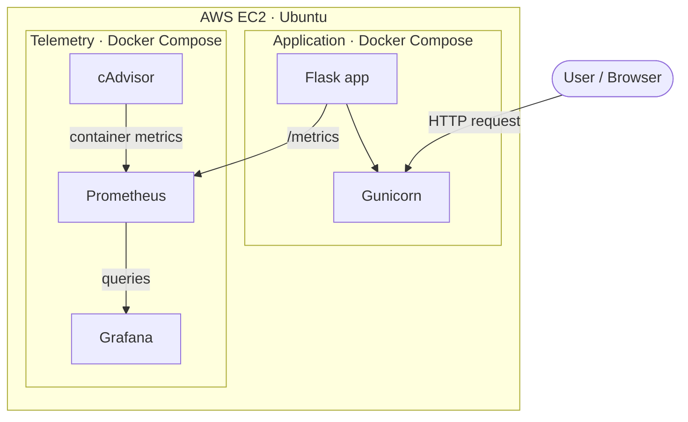
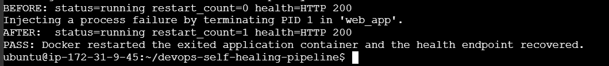

# Automated Self-Healing Microservices & Telemetry Pipeline


## 1. Project Overview

This project runs a containerized Flask application with Gunicorn and a Docker Compose monitoring stack. It is designed for an Ubuntu host such as AWS EC2 and includes cAdvisor, Prometheus, and Grafana services.

The `web_app` service uses a Docker health check and the `restart: always` policy. The recovery demonstration intentionally terminates the app's main process, then confirms Docker restarted the container and the `/health` endpoint recovered.

## 2. Project Objectives

- Package the Flask application and supporting components in containers.
- Deploy the stack on an Ubuntu-based AWS EC2 instance using Docker Compose.
- Collect and visualize configured telemetry with Prometheus and Grafana.
- Observe container resource usage through cAdvisor, where configured.
- Demonstrate recovery behavior using only the mechanisms present in the project.
- Document setup, operation, troubleshooting, and security considerations.

## 3. Architecture Overview

The diagram reflects the configured Compose services and Prometheus scrape flow.



### Data Flow

1. Gunicorn serves the Flask application and exposes request counters and latency histograms at `/metrics`.
2. Prometheus scrapes the Flask app and cAdvisor every five seconds and evaluates the rules in `monitoring/alerts.yml`.
3. Grafana loads its Prometheus data source and dashboard from the version-controlled provisioning files.
4. Operators inspect request rate, p95 latency, scrape target availability, and container CPU and memory usage.

## 4. Technology Stack

| Technology | Stated or example role |
|---|---|
| AWS EC2 | Cloud virtual machine hosting the deployment |
| Ubuntu | EC2 operating system |
| Docker | Container runtime |
| Docker Compose | Multi-container application definition and lifecycle |
| Python | Application language |
| Flask | Web application framework |
| Gunicorn | WSGI application server |
| cAdvisor | Container CPU and memory telemetry |
| Prometheus | Scrapes app and container metrics and evaluates availability alert rules |
| Grafana | Provisioned Prometheus data source and service overview dashboard |

## 5. Key Engineering Highlights

The repository includes:

- **Containerized application:** Flask served by Gunicorn in the `web_app` Compose service.
- **Repeatable startup:** Docker Compose builds and runs the application and monitoring services.
- **Process recovery:** Docker restarts the application container when its main process exits; the recovery script verifies the restart count and health endpoint.
- **Container telemetry:** cAdvisor is configured as a Prometheus scrape target.
- **Application observability:** `/metrics` exports HTTP request counts and request duration histograms.
- **Dashboards and alerts:** Grafana dashboard and Prometheus availability rules are provisioned from the repository.
- **CI/CD:** GitHub Actions validates Compose, builds the application image, checks monitoring configuration, then deploys to EC2 when configured.
- **Operational guidance:** Bash script and instructions for deployment, recovery, and cleanup.

## 6. Deployment & Quick Start

These commands target Ubuntu/Linux Bash. On EC2, connect over SSH and run them there. Keep inbound security-group access restricted; the recovery test checks the app through localhost and does not require opening port 5000 publicly.

### Prerequisites

- An Ubuntu AWS EC2 instance with Docker Engine and the Docker Compose plugin installed.
- Git, if cloning the project onto the instance.
- A strong Grafana admin password stored in `.env` (never commit this file).
- Network access limited to the ports needed by your deployment.
- An EC2 instance or other Ubuntu host with enough disk space for the container images.

### Deploy the stack

```bash
git clone https://github.com/preethikakarla551/devops-self-healing-pipeline.git
cd devops-self-healing-pipeline
cp .env.example .env
# Edit .env and replace the placeholder with a strong, unique password.
sudo docker compose config
sudo docker compose up -d --build
sudo docker compose ps
sudo docker compose logs --tail=100
```

When Docker requires elevated privileges, prefix Docker commands with `sudo`.

### Services and ports

- Flask application: `http://localhost:5000/`
- Health check: `http://localhost:5000/health`
- Application metrics: `http://localhost:5000/metrics`
- Prometheus: host port `9090`
- Grafana: host port `3000`
- cAdvisor: host port `8081` (container port `8080`).

Prometheus, Grafana, and cAdvisor bind to localhost on the host; they are not published to the public network. For an EC2 deployment, view Grafana and Prometheus through an SSH tunnel, for example:

```bash
ssh -i <your-key.pem> -L 3000:127.0.0.1:3000 -L 9090:127.0.0.1:9090 ubuntu@<EC2_PUBLIC_IP>
```

Then open Grafana at `http://localhost:3000` and sign in as `admin` with the password from `.env`. The GitHub Actions deploy workflow also needs repository secrets named `EC2_HOST`, `EC2_USERNAME`, `EC2_SSH_KEY`, and `GRAFANA_ADMIN_PASSWORD`.

## 7. Observability & Telemetry

The Flask app exports `flask_http_requests_total` (method, endpoint, and status labels) and `flask_http_request_duration_seconds` (method and endpoint labels). Metrics requests are excluded from these application measurements. Prometheus scrapes `web_app:5000/metrics` and `cadvisor:8080`; the `up` metric shows scrape target availability.

Grafana provisions the Prometheus data source and `DevOps Service Overview` dashboard automatically. The dashboard includes request rate, p95 latency, target availability, and cAdvisor container CPU/memory charts. Prometheus defines `FlaskApplicationDown` and `CAdvisorDown` rules in `monitoring/alerts.yml`. These rules are visible in Prometheus, but no Alertmanager or email/chat notification receiver is configured.

Check target status at `http://localhost:9090/targets` and rule status at `http://localhost:9090/alerts`.

## 8. Self-Healing & Recovery

The `web_app` service has `restart: always` and an HTTP health check for `/health`. Docker restarts the container after its main process exits. A health check reports whether the endpoint responds; by itself, an unhealthy status does not make Docker restart a still-running process. This project demonstrates process-exit recovery, not repair of application bugs or bad configuration.

Run the repeatable failure demonstration from the repository root:

```bash
sudo bash scripts/demo_recovery.sh
```

The script checks initial health, terminates PID 1 in `web_app`, waits for Docker to restart it, and verifies a higher restart count plus a successful health request. A successful run looks like:

```text
BEFORE: status=running restart_count=1 health=HTTP 200
Injecting a process failure by terminating PID 1 in 'web_app'.
AFTER:  status=running restart_count=2 health=HTTP 200
PASS: Docker restarted the application container and the health endpoint recovered.
```

Counts vary between runs. The test causes a brief interruption while the container restarts. Use `sudo` for the script when your account needs elevated Docker access.

## 9. Troubleshooting

| Symptom | Checks |
|---|---|
| A service is not running | Review `sudo docker compose ps` and `sudo docker compose logs web_app`; confirm the image build completed. |
| Application endpoint is unreachable | Confirm the container is healthy or running, the port is published, the EC2 security group and host firewall allow the intended source, and the application binds to the expected interface. |
| Prometheus target is down | Check the target's configured address from Prometheus's network, the scrape path and port, and the target service state. Use the actual target name from the configuration. |
| Grafana has no data | Confirm Grafana's Prometheus data source URL, Prometheus target health, time range, and that the dashboard queries use real metric names. |
| Container repeatedly restarts | Inspect `sudo docker compose logs web_app` and the exit status; verify configuration, resource availability, dependencies, and health-check behavior before changing restart settings. |
| SSH session disconnects | Reconnect using the correct key and EC2 address. Check server status and network connectivity; avoid editing files in an interrupted remote session until verifying whether changes were saved. |

Useful diagnostic commands:

```bash
sudo docker compose ps
sudo docker compose logs --tail=100 web_app
sudo docker compose config
sudo docker stats
sudo docker inspect --format 'status={{.State.Status}} restart_count={{.RestartCount}} health={{.State.Health.Status}}' web_app
curl --fail http://localhost:5000/health
```

## 10. Security Best Practices

- Restrict SSH and application access to trusted source addresses wherever practical.
- Keep secrets, private keys, passwords, and production environment files out of Git.
- Use least-privilege IAM and host access; avoid unnecessary public exposure of Prometheus, Grafana, or cAdvisor.
- Use strong, unique Grafana credentials and enable authentication for any remotely accessible dashboard.
- Keep Ubuntu, Docker, Python dependencies, and container images maintained.
- Use pinned image and dependency versions where appropriate, and review updates before deployment.
- Use TLS for traffic that crosses untrusted networks.
- Back up configuration and any persistent data that matters; test recovery procedures.
- Review container privileges, mounted host paths, and published ports in the Compose file.

## 11. Future Enhancements

Optional next steps beyond this portfolio demo:

- Add TLS termination, authentication, and centralized secret management.
- Configure Alertmanager and test a real notification receiver.
- Add an authenticated reverse proxy if dashboards must be accessed remotely.
- Pin and regularly update container base images and monitoring image versions.
- Add application-level tests and resource limits as the service grows.
- Add automated deployment rollback and recovery tests.

## CI/CD workflow

The GitHub Actions workflow runs when application, Docker, monitoring, or workflow files change on `main`, and can also be started manually. It validates the Compose configuration, builds the application image, checks the Prometheus rules and Grafana dashboard JSON, and then deploys the updated stack over SSH. Configure the four repository secrets listed above before enabling automatic EC2 deployment. The workflow does not run an application test suite yet.

## 12. Resume & Portfolio Highlights

Use only claims you have personally run and verified:

- Containerized a Flask/Gunicorn service and monitoring stack with Docker Compose.
- Configured Docker health checks and restart policy; demonstrated recovery after terminating the application process.
- Exported Flask request and latency metrics and configured Prometheus to scrape the app and cAdvisor.
- Provisioned Grafana dashboards and Prometheus availability alert rules as code.
- Deployed the stack to Ubuntu on EC2 and demonstrated Docker restart recovery (see the recovery proof below).

## 13. Skills Demonstrated

Skills represented in the repository:

- Ubuntu/Linux administration on AWS EC2
- Docker and Docker Compose
- Python and Flask
- Gunicorn and WSGI deployment
- Prometheus application/container metrics, PromQL, and alert rules
- Grafana provisioning and dashboards
- cAdvisor container monitoring
- GitHub Actions CI/CD and SSH-based EC2 deployment
- Linux troubleshooting and service operations
- Application and infrastructure observability
- Deployment documentation and security fundamentals

## Recovery proof


